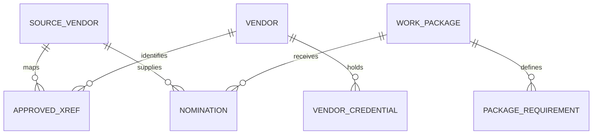

# Power Plant Vendor Reference Data

A fictional power plant project needs a vendor shortlist for boiler installation, turbine-hall lifting, and electrical works. The ERP and contractor portal carry different vendor records. This case study shows how to resolve them to a legal entity, verify package-specific evidence, and explain every eligibility decision.

All names, identifiers, qualifications, and rules are synthetic. Eligibility means the vendor passed this fictional data screen on the run date.

| Design choice | What it demonstrates |
| --- | --- |
| Effective-dated source-to-master crosswalk | Correct a vendor mapping while preserving earlier decisions |
| Separate candidate matches | Route ambiguous aliases to a steward without approving them based on a score |
| Site and package qualification | Evaluate each required credential as of the run date and retain the evidence status |
| Two reporting grains | Preserve each source nomination for audit and deduplicate the vendor shortlist by legal entity and package |

## Run in Snowflake

Use an empty scratch schema and an active warehouse. Run [schema](sql/01_schema.sql), [synthetic fixtures](sql/02_seed.sql), and [model](sql/03_model.sql) in order. Run the [release controls](sql/04_controls.sql) and confirm that each query returns zero rows before running the [reports](sql/05_reporting.sql).

### Expected results on June 1, 2025

| Nomination | Decision | Explanation |
| --- | --- | --- |
| N01 and N02 | Eligible | ERP and portal both resolve to V01, and North site HSE and welding evidence pass |
| N03 | Qualification gap | The welding credential expires at the June 1 boundary |
| N04 | Qualification gap | The lift plan is for South, while the package is at North |
| N05 | Identity review | Two candidate matches and no approved crosswalk entry |
| N06 | Qualification gap | The electrical qualification is revoked effective June 1 |
| N07 | Vendor hold | Both credentials pass, but the master record is on hold |

The shortlist contains **one row**, V01 for PKG-BOILER, supported by **two nominations**. The steward can trace each nomination to its approved mapping and each qualification result to its evidence. See the [architecture decisions](docs/architecture.md) and [steward runbook](docs/runbook.md).
